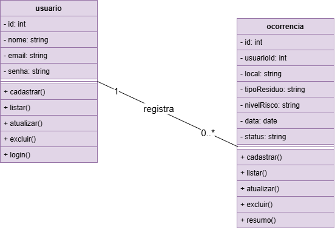

# Gestão de Resíduos Sólidos

Projeto desenvolvido para a disciplina de Programação Back-End do curso Técnico em Desenvolvimento de Sistemas do SENAI.

O objetivo é desenvolver uma API REST para gerenciar usuários e ocorrências relacionadas à gestão de resíduos sólidos, utilizando Node.js, Express e MariaDB.

## Tecnologias utilizadas

- Node.js
- Express
- MariaDB
- MySQL
- Thunder Client

## Funcionalidades

- Cadastro de usuários
- Listagem de usuários
- Atualização de usuários
- Exclusão de usuários
- Login de usuários
- Cadastro de ocorrências
- Listagem de ocorrências
- Atualização de ocorrências
- Exclusão de ocorrências
- Resumo de ocorrências tratadas

## Banco de Dados

O projeto utiliza o banco de dados `gestao_residuos`, composto pelas tabelas `usuario` e `ocorrencia`.

## Diagrama de Classes



## Testes da API

Os testes das rotas foram realizados utilizando o Thunder Client.

As imagens dos testes estão disponíveis na pasta `docs`.

## Como executar o projeto

1. Clone o repositório.
2. Instale as dependências:

```bash
npm install
